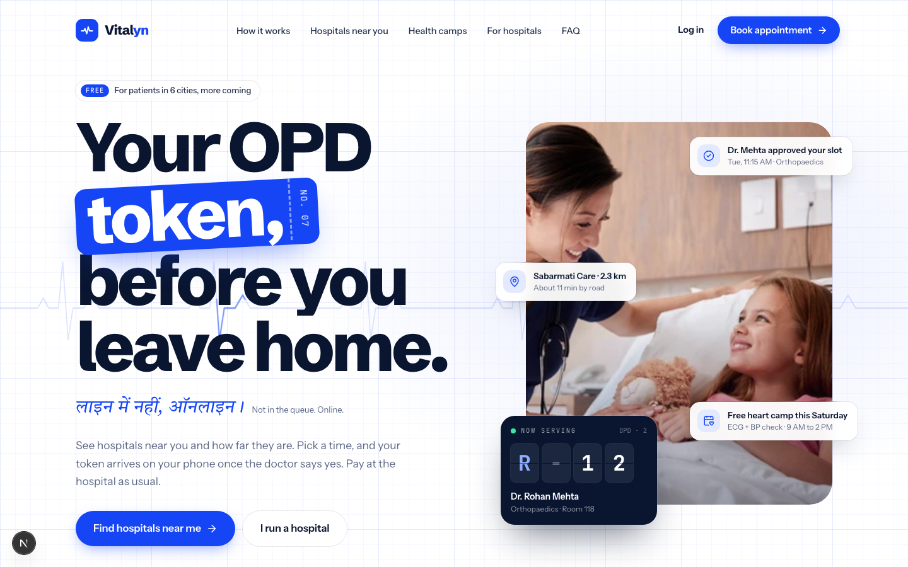
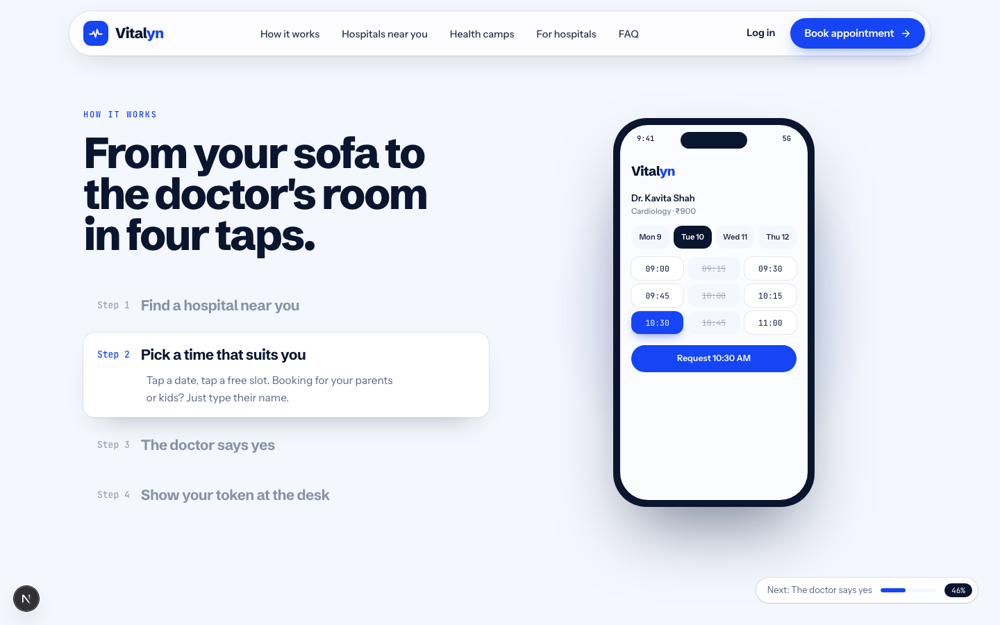
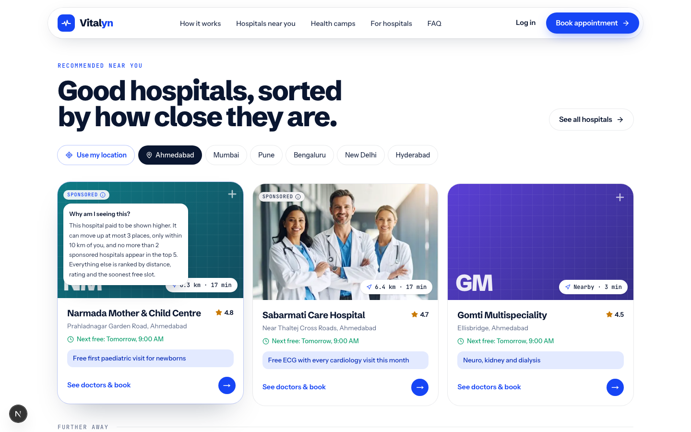
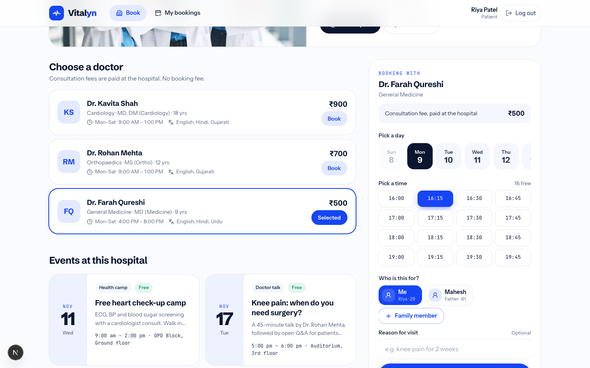
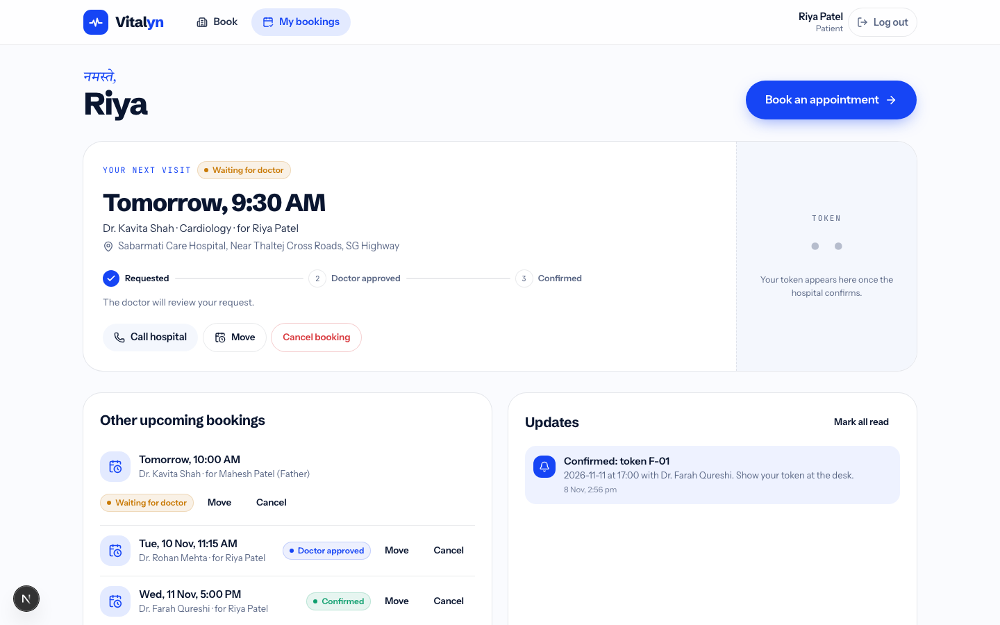
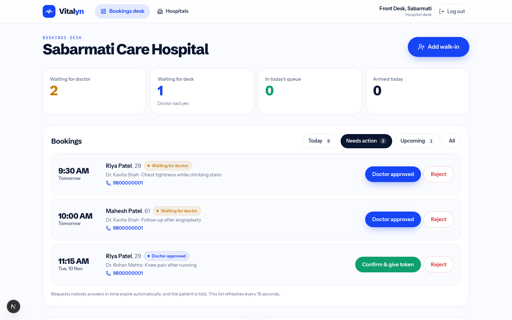
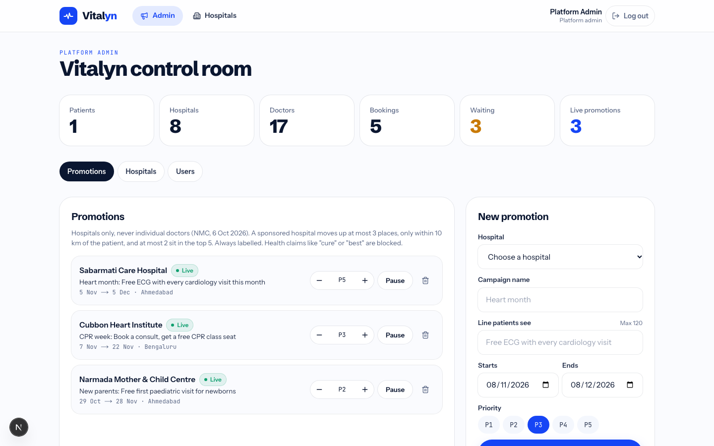
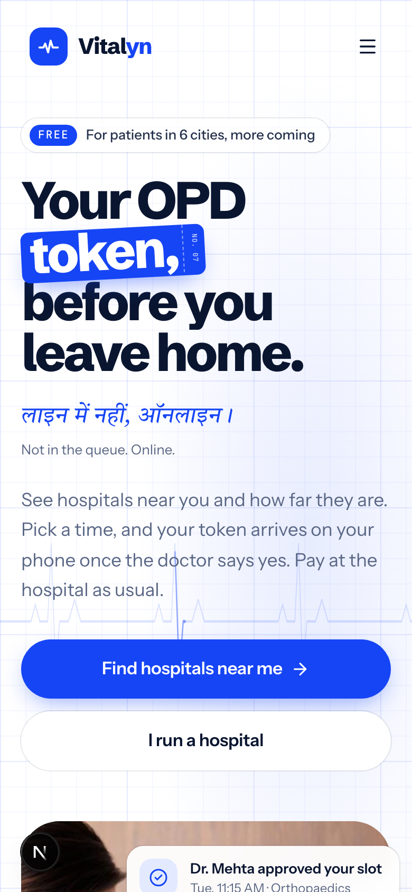
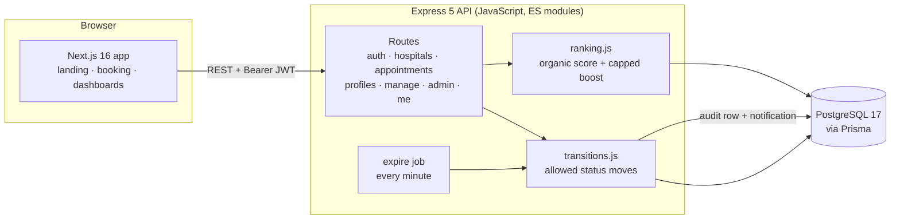
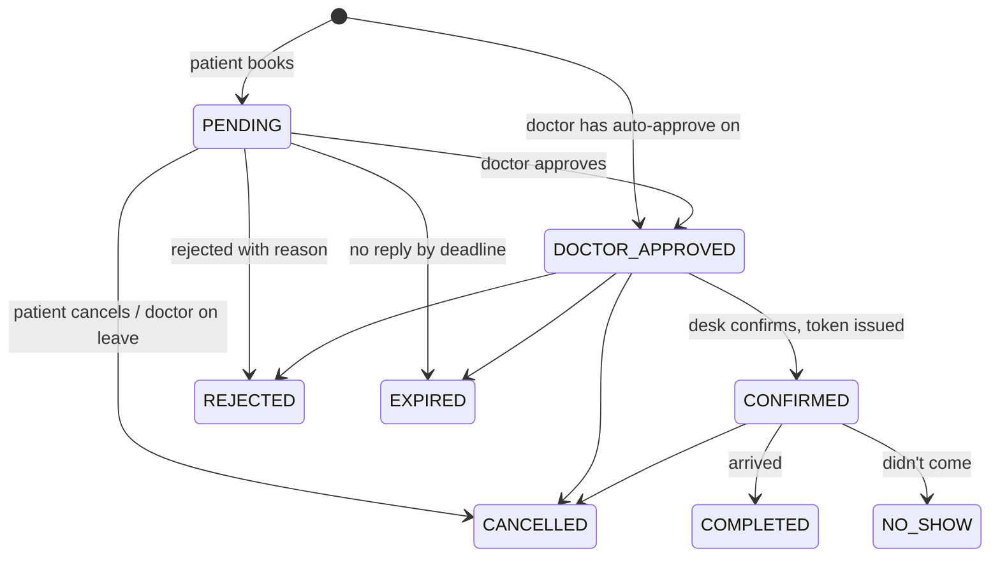

<div align="center">

# Vitalyn

**Your OPD token, before you leave home.**
<br/>
<em>लाइन में नहीं, ऑनलाइन।</em>

Hospital appointment booking built for India. Patients find hospitals near them, see how far they are, book a real OPD slot for themselves or their family, and get a token once the doctor and hospital desk approve.




</div>

---

## Contents

- [What it does](#what-it-does)
- [Screenshots](#screenshots)
- [Architecture](#architecture)
- [Booking lifecycle](#booking-lifecycle)
- [Getting started](#getting-started)
- [Demo accounts](#demo-accounts)
- [API reference](#api-reference)
- [Recommendations and sponsored listings](#recommendations-and-sponsored-listings)
- [Privacy and compliance](#privacy-and-compliance)
- [Project structure](#project-structure)
- [Deploying](#deploying)
- [Roadmap](#roadmap)

## What it does

Vitalyn has four kinds of users. Everything is done with buttons, because the people at a hospital front desk are not there to fill in forms.

| Who | What they can do |
|---|---|
| **Patient** | Find hospitals nearest first (GPS, city, area or PIN code), see distance, travel time and the next free slot, book a slot in three taps, book for up to 6 family members, move or cancel a booking, follow each approval step, see the token, get in-app updates, download or delete their data |
| **Hospital desk** | Work from a **Today** queue sorted by token, approve / confirm / reject (with a one-tap reason), mark **Arrived**, **Didn't come** or **Paid**, add a **walk-in** in two taps, set each doctor's OPD days and hours, mark a doctor **on leave**, post health camps and events |
| **Doctor** | See only their own patients, approve or reject requests, mark themselves on leave |
| **Platform admin** | Run **sponsored hospital** promotions (with priority, dates and pause), verify hospitals and record their registration and ABDM HFR IDs, see bookings, cancellations, no-shows and expiries per hospital |

## Screenshots

| | |
|---|---|
|  |  |
| **How it works** · pinned, scroll-driven, with a live phone mock-up | **Recommended near you** · organic ranking, labelled sponsored slots |
|  |  |
| **Booking** · day, time, "who is this for?", one button | **Patient dashboard** · next visit, token, progress, move or cancel |
|  |  |
| **Hospital desk** · every decision is a button | **Admin** · promotions, hospitals, users |

<p align="center"></p>

## Architecture

The frontend and backend are separate apps with their own `package.json`, so each can be run, debugged and deployed on its own.



| Layer | Choices |
|---|---|
| Frontend | Next.js 16 (App Router), React 19, TypeScript, Tailwind CSS v4, Motion, Lenis smooth scroll, lucide icons |
| Backend | Express 5, JavaScript (ES modules), Zod validation, JWT auth, bcrypt, Helmet |
| Data | PostgreSQL 17, Prisma 6, partial unique indexes for slot safety |
| Local dev | Docker Compose for Postgres, Playwright for screenshots and end-to-end checks |

## Booking lifecycle



- **One place for every move.** `backend/src/lib/transitions.js` checks each status change, assigns tokens, writes an `AppointmentEvent` audit row and queues a patient update.
- **No double booking.** PostgreSQL partial unique indexes allow only one active booking per doctor slot and one token number per doctor per day. Two people pressing "Book" at the same moment get one booking and one "slot just taken" message.
- **Deadlines.** A request must be confirmed by the earlier of 2 hours after booking or 2 hours before the slot (never less than 15 minutes). A background job expires late requests and tells the patient.
- **Reschedule safely.** Moving a booking is a single update, so the old slot is released only if the new one is free.
- **Walk-ins** take the next token in the same queue as online bookings.

## Getting started

You need **Node 20+** and **Docker**.

```bash
git clone https://github.com/Tejmul/Vitalyn.git
cd Vitalyn

# 1. Database
docker compose up -d

# 2. API  →  http://localhost:4000/api
cd backend
npm install
cp .env.example .env              # set a long random JWT_SECRET
npx prisma migrate deploy
npm run db:seed
npm run dev

# 3. Website  →  http://localhost:3000   (new terminal)
cd frontend
npm install
cp .env.example .env.local        # NEXT_PUBLIC_API_URL=http://localhost:4000/api
npm run dev
```

| Command (in `backend/`) | Does |
|---|---|
| `npm run dev` | API with auto-reload |
| `npm run db:seed` | Reload demo data |
| `npm run db:reset` | Wipe, migrate and seed |
| `npm run db:migrate` | Create a migration after editing `schema.prisma` |
| `npm run studio` | Browse the database in Prisma Studio |

## Demo accounts

The login page has one-tap buttons for these in development.

| Role | Email | Password |
|---|---|---|
| Patient (with a family member) | `user@vitalyn.in` | `User@1234` |
| Hospital desk, Sabarmati Care | `hospital@vitalyn.in` | `Hospital@1234` |
| Doctor, Dr. Kavita Shah | `doctor@vitalyn.in` | `Doctor@1234` |
| Platform admin | `admin@vitalyn.in` | `Admin@1234` |

All hospitals, doctors and events in the seed data are fictional.

## API reference

Base URL `/api`. Authenticated routes need `Authorization: Bearer <token>`. Errors come back as `{ "error": "plain-language message" }`.

<details>
<summary><strong>Auth and account</strong></summary>

| Method | Path | Who | Notes |
|---|---|---|---|
| POST | `/auth/register` | anyone | name, email, username, phone (optional), password, `consent: true` |
| POST | `/auth/login` | anyone | `identifier` (email, username or phone) + password |
| GET | `/auth/me` | logged in | current user |
| GET | `/me/notifications` | logged in | latest updates + unread count |
| POST | `/me/notifications/read` | logged in | mark all read |
| GET | `/me/export` | patient | download everything we hold (JSON) |
| DELETE | `/me` | patient | delete account (password required); bookings are anonymised |

</details>

<details>
<summary><strong>Hospitals and events</strong></summary>

| Method | Path | Notes |
|---|---|---|
| GET | `/hospitals?lat&lng&q&specialty&city` | nearest first; `q` matches name, area, city, PIN code or speciality |
| GET | `/hospitals/recommendations?lat&lng&radiusKm` | ranked list with capped sponsored boost |
| GET | `/hospitals/specialties` | filter chips |
| GET | `/hospitals/:slug` | hospital, doctors (with hours and leave days), upcoming events |
| GET | `/hospitals/doctors/:id/slots?date=YYYY-MM-DD` | each slot with `available` |
| GET | `/events` | upcoming events across hospitals |

</details>

<details>
<summary><strong>Patients</strong></summary>

| Method | Path | Notes |
|---|---|---|
| GET / POST | `/profiles` | family members (up to 6), optional ABHA number |
| PATCH / DELETE | `/profiles/:id` | edit or remove (your own profile can't be removed) |
| POST | `/appointments` | `doctorId`, `date`, `time`, `profileId`, `reason?` |
| GET | `/appointments/me` | all bookings |
| POST | `/appointments/:id/cancel` | any time before the visit |
| POST | `/appointments/:id/reschedule` | `date`, `time`; up to 2 hours before |

</details>

<details>
<summary><strong>Hospital desk and doctors</strong></summary>

| Method | Path | Who | Notes |
|---|---|---|---|
| GET | `/manage/overview` | hospital, doctor | counts for the top tiles |
| GET | `/manage/appointments?status&date` | hospital, doctor | doctors see only their own |
| POST | `/manage/appointments/:id/action` | hospital, doctor | `approve` · `confirm` · `reject` · `arrive` · `no_show` |
| POST | `/manage/appointments/:id/paid` | hospital | fee collected |
| POST | `/manage/walk-ins` | hospital | `doctorId`, `name`, `phone?`, `age?` → next token |
| GET | `/manage/doctors` | hospital, doctor | with upcoming leave |
| PATCH | `/manage/doctors/:id` | hospital | OPD days, hours, slot length, auto-approve |
| POST / DELETE | `/manage/doctors/:id/leave` | hospital, doctor | cancels that day's bookings and notifies patients |
| GET / POST / DELETE | `/manage/events` | hospital | health camps, drives, talks |

</details>

<details>
<summary><strong>Admin</strong></summary>

| Method | Path | Notes |
|---|---|---|
| GET | `/admin/overview` | platform totals |
| GET | `/admin/hospitals` | per-hospital bookings, arrivals, cancellations, no-shows, expiries |
| PATCH | `/admin/hospitals/:id` | verify, registration number, ABDM HFR ID |
| GET | `/admin/users` | recent sign-ups |
| GET / POST | `/admin/promotions` | list, create |
| PATCH / DELETE | `/admin/promotions/:id` | pause, resume, priority, delete |

</details>

## Recommendations and sponsored listings

India's National Medical Commission issued Guidelines on Ethical Advertising on 6 October 2026 that ban paid ranking of doctors on platforms. So Vitalyn only sells placement to **hospitals**, and money can move a result only a little:

1. **Filter.** Verified hospitals with a free slot in the next 7 days.
2. **Rank organically.** Distance 50%, rating 25%, soonest free slot 25%.
3. **Capped boost.** A sponsored hospital moves up at most **3 places**, only within **10 km**, and at most **2** sponsored cards sit in the top 5.
4. **Label it.** Every sponsored card says so, with a "Why am I seeing this?" explanation.
5. **Block claims.** Event and promotion text can't use words like "cure", "guaranteed", "best" or "No.1" (`backend/src/lib/claims.js`).

## Privacy and compliance

Built with India's Digital Personal Data Protection Act, 2023 in mind:

- Sign-up needs consent to a plain-language [privacy notice](frontend/src/app/(app)/privacy/page.tsx); the version agreed to is stored.
- Patients can **download their data** and **delete their account** from the dashboard.
- A hospital only sees its own bookings; a doctor only sees their own patients.
- Every booking change is written to an audit log.
- We collect the minimum: name, age, gender, relation, and an optional reason for visit.

The full research behind these choices (15 apps compared, Indian regulations, monetisation, roadmap) is in [`docs/research`](docs/research/india-hospital-booking-research.pdf).

## Project structure

```
Vitalyn/
├── backend/                     Express API (JavaScript)
│   ├── prisma/
│   │   ├── schema.prisma        data model
│   │   ├── migrations/          SQL migrations (incl. partial unique indexes)
│   │   └── seed.js              demo data
│   └── src/
│       ├── routes/              auth, hospitals, events, appointments, profiles, manage, admin, me
│       ├── lib/                 transitions, ranking, slots, geo, claims, notify
│       ├── middleware/          JWT auth, error handling
│       └── jobs/expire.js       expires unanswered requests
├── frontend/                    Next.js app (TypeScript)
│   ├── public/images/           photos
│   └── src/
│       ├── app/                 routes: landing, (auth), (app)
│       ├── components/          landing, app, dashboard, ui
│       └── lib/                 API client, auth, location, formatting
├── docs/                        screenshots and research
└── docker-compose.yml           local PostgreSQL
```

## Deploying

| Part | Where | Settings |
|---|---|---|
| Database | Any managed Postgres in an Indian region (e.g. AWS RDS Mumbai) | run `npx prisma migrate deploy` |
| Backend | Railway, Render, a VM or container | `DATABASE_URL`, `JWT_SECRET`, `CORS_ORIGIN`, `NODE_ENV=production`, then `npm start` |
| Frontend | Vercel (Mumbai region) or any Node host | `NEXT_PUBLIC_API_URL` pointing at the API |

The expiry job runs inside the API process. With more than one API instance, move it to a single worker.

## Roadmap

- [x] Hospital search by distance, area and PIN code
- [x] Real slots, family profiles, reschedule and cancel
- [x] Doctor approval, desk confirmation, tokens, walk-ins
- [x] Doctor schedules and leave
- [x] Capped, labelled sponsored hospitals
- [x] Audit log, in-app updates, data export and deletion
- [ ] Phone OTP login (MSG91 + DLT registration)
- [ ] WhatsApp and SMS updates from the notification outbox
- [ ] UPI prepayment with automatic refunds (Razorpay)
- [ ] Live "Now serving" queue screen for hospital TVs
- [ ] Hindi and regional languages
- [ ] Verified reviews after a visit
- [ ] ABDM: ABHA linking and Scan & Share
