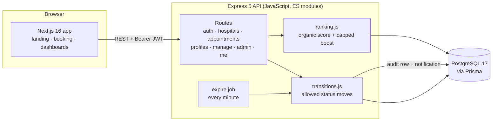
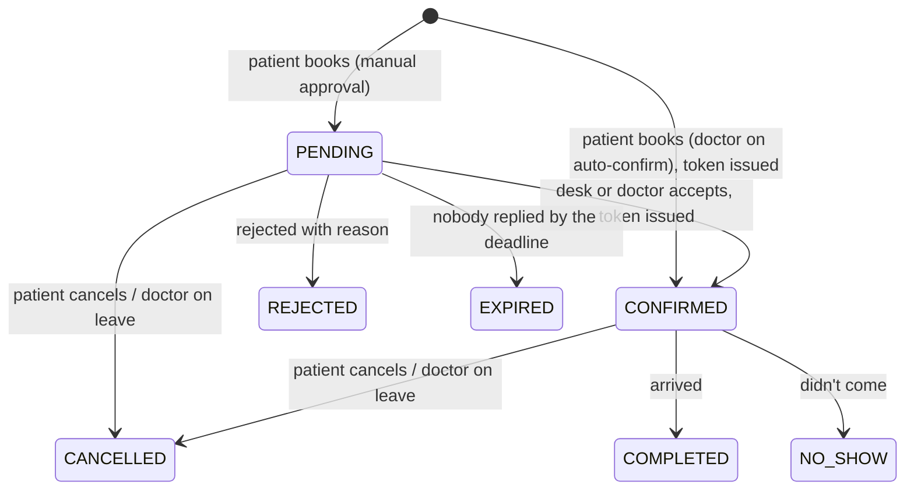

<div align="center">

# Vitalyn

**Your OPD token, before you leave home.**
<br/>
<em>लाइन में नहीं, ऑनलाइन।</em>

Hospital appointment booking built for India. Patients find hospitals near them, see how far they are, book a real OPD slot for themselves or their family, and get a token once the doctor and hospital desk approve.


</div>

---

## Contents

- [What it does](#what-it-does)
- [Screenshots](#screenshots)
- [Architecture](#architecture)
- [Booking lifecycle](#booking-lifecycle)
- [Getting started](#getting-started)
- [Demo accounts](#demo-accounts)
- [API reference](#api-reference)
- [Recommendations and sponsored listings](#recommendations-and-sponsored-listings)
- [Privacy and compliance](#privacy-and-compliance)
- [Project structure](#project-structure)
- [Deploying](#deploying)
- [Roadmap](#roadmap)

## What it does

Vitalyn has four kinds of users. Everything is done with buttons, because the people at a hospital front desk are not there to fill in forms.

| Who | What they can do |
|---|---|
| **Patient** | Save hospitals to **My hospitals**, **Book again** from past visits, WhatsApp the hospital desk, find hospitals nearest first (GPS, city, area or PIN code), see distance, travel time and the next free slot, book a slot in three taps, book for up to 6 family members, move or cancel a booking, follow each approval step, see the token, get in-app updates, download or delete their data |
| **Hospital desk** | Add and edit **doctors** (with council/HPR registration number), work from a **Today** queue sorted by token, approve / confirm / reject (with a one-tap reason), mark **Arrived**, **Didn't come** or **Paid**, add a **walk-in** in two taps, set each doctor's OPD days and hours, mark a doctor **on leave**, post health camps and events |
| **Doctor** | See only their own patients, accept or reject requests (when not on auto-confirm), mark themselves on leave |
| **Platform admin** | Review **hospital applications** from /list-your-hospital, verify accreditations and doctor registration numbers, keep the **audit** and **incident** logs, run **sponsored hospital** promotions (with priority, dates and pause), verify hospitals and record their registration and ABDM HFR IDs, see bookings, cancellations, no-shows and expiries per hospital |

## Screenshots

| | |
|---|---|
|  |  |
| **How it works** · pinned, scroll-driven, with a live phone mock-up | **Recommended near you** · organic ranking, labelled sponsored slots |
|  |  |
| **Booking** · day, time, "who is this for?", one button | **Patient dashboard** · next visit, token, progress, move or cancel |
|  |  |
| **Hospital desk** · every decision is a button | **Admin** · promotions, hospitals, users |

<p align="center"></p>

## Architecture

The frontend and backend are separate apps with their own `package.json`, so each can be run, debugged and deployed on its own.



| Layer | Choices |
|---|---|
| Frontend | Next.js 16 (App Router), React 19, TypeScript, Tailwind CSS v4, Motion, Lenis smooth scroll, lucide icons |
| Backend | Express 5, JavaScript (ES modules), Zod validation, JWT auth, bcrypt, Helmet |
| Data | PostgreSQL 17, Prisma 6, partial unique indexes for slot safety |
| Local dev | Docker Compose for Postgres, Playwright for screenshots and end-to-end checks |

## Booking lifecycle



- **One place for every move.** `backend/src/lib/transitions.js` checks each status change, assigns tokens, writes an `AppointmentEvent` audit row and queues a patient update.
- **No double booking.** PostgreSQL partial unique indexes allow only one active booking per doctor slot and one token number per doctor per day. Two people pressing "Book" at the same moment get one booking and one "slot just taken" message.
- **One approver per doctor.** Doctors are on **auto-confirm** by default: the booking is confirmed and the token issued at once. Turn it off and either the desk or the doctor taps Accept or Reject.
- **Tokens never collide.** Token numbers are assigned under a per-doctor, per-day PostgreSQL advisory lock, and a unique index backs it up.
- **Deadlines.** A manual-approval request must be accepted by the earlier of 2 hours after booking or 2 hours before the slot (never less than 15 minutes). A background job expires late requests and tells the patient.
- **Reschedule safely.** Moving a booking is a single update, so the old slot is released only if the new one is free.
- **Walk-ins** take the next token in the same queue as online bookings.
- **Live queue.** The desk presses **Call next** (under the same per-doctor lock), the waiting-room TV at `/queue/<hospital>` shows "Now serving" (tokens only), patients see how many are ahead with a rough wait (people ahead × slot length), and anyone 2 or fewer away gets one "your turn is near" alert.

## Getting started

You need **Node 20+** and **Docker**.

```bash
git clone https://github.com/Tejmul/Vitalyn.git
cd Vitalyn

# 1. Database
docker compose up -d

# 2. API  →  http://localhost:4000/api
cd backend
npm install
cp .env.example .env              # set a long random JWT_SECRET; MSG91 keys optional in dev
npx prisma migrate deploy
npm run db:seed
npm run dev

# 3. Website  →  http://localhost:3000   (new terminal)
cd frontend
npm install
cp .env.example .env.local        # NEXT_PUBLIC_API_URL=http://localhost:4000/api
npm run dev
```

| Command (in `backend/`) | Does |
|---|---|
| `npm run dev` | API with auto-reload |
| `npm run db:seed` | Reload demo data |
| `npm run db:reset` | Wipe, migrate and seed |
| `npm run db:migrate` | Create a migration after editing `schema.prisma` |
| `npm run studio` | Browse the database in Prisma Studio |

## Demo accounts

Everyone logs in with a mobile number and a one-time code. Without MSG91 keys (development), no SMS is sent: the code is shown on the login screen and printed in the API log. The login page also has one-tap demo buttons.

| Role | Mobile |
|---|---|
| Patient (with a family member) | `98000 00001` |
| Hospital desk, Sabarmati Care | `98000 00002` |
| Doctor, Dr. Kavita Shah | `98000 00003` |
| Platform admin | `98000 00004` |

All hospitals, doctors and events in the seed data are fictional.

## API reference

Base URL `/api`. Authenticated routes need `Authorization: Bearer <token>`. Errors come back as `{ "error": "plain-language message" }`.

<details>
<summary><strong>Auth and account</strong></summary>

| Method | Path | Who | Notes |
|---|---|---|---|
| POST | `/auth/otp/request` | anyone | `phone` → 6-digit code by SMS (one per 30 s, three per 10 min) |
| POST | `/auth/otp/verify` | anyone | `phone`, `code` → session; for a new number `{ needsProfile, signupToken }` |
| POST | `/auth/complete-profile` | new number | `signupToken`, `name`, `email?`, `consent: true`, `adult: true` |
| POST | `/auth/refresh` | refresh cookie | new 15-minute access token; rotates the cookie |
| POST | `/auth/logout` | logged in | ends the session |
| GET | `/auth/me` | logged in | current user |
| GET | `/me/notifications` | logged in | latest updates + unread count |
| POST | `/me/notifications/read` | logged in | mark all read |
| GET | `/me/export` | patient | download everything we hold (JSON) |
| POST | `/me/delete-code` | patient | texts a confirmation code |
| DELETE | `/me` | patient | delete account with that `code`; bookings are anonymised |

</details>

<details>
<summary><strong>Hospitals and events</strong></summary>

| Method | Path | Notes |
|---|---|---|
| GET | `/hospitals?lat&lng&q&specialty&city` | nearest first; `q` matches name, area, city, PIN code or speciality |
| GET | `/hospitals/recommendations?lat&lng&radiusKm` | ranked list with capped sponsored boost |
| GET | `/hospitals/specialties` | filter chips |
| GET | `/hospitals/:slug` | hospital, doctors (with hours and leave days), upcoming events |
| GET | `/hospitals/doctors/:id/slots?date=YYYY-MM-DD` | each slot with `available` |
| GET | `/hospitals/:slug/reviews` | visible verified reviews (first name + initial) with the average |
| GET | `/hospitals/:slug/queue` | public "Now serving" board (tokens only, no names) for the waiting-room TV at `/queue/:slug` |
| GET | `/events` | upcoming events across hospitals |

</details>

<details>
<summary><strong>Patients</strong></summary>

| Method | Path | Notes |
|---|---|---|
| GET / POST | `/profiles` | family members (up to 6), optional ABHA number |
| GET | `/saved` | "My hospitals" |
| PUT / DELETE | `/saved/:hospitalId` | save or remove a hospital |
| PATCH / DELETE | `/profiles/:id` | edit or remove (your own profile can't be removed) |
| POST | `/appointments` | `doctorId`, `date`, `time`, `profileId`, `reason?` |
| GET | `/appointments/me` | all bookings |
| POST | `/appointments/:id/cancel` | any time before the visit |
| POST | `/appointments/:id/reschedule` | `date`, `time`; up to 2 hours before |
| GET | `/appointments/:id/queue` | on the day: now serving, people ahead, rough wait |
| POST | `/appointments/:id/review` | `rating` 1–5, `comment?`, `consent: true`; only after Arrived, once, within 30 days |

</details>

<details>
<summary><strong>Hospital desk and doctors</strong></summary>

| Method | Path | Who | Notes |
|---|---|---|---|
| GET | `/manage/overview` | hospital, doctor | counts for the top tiles |
| GET | `/manage/appointments?status&date` | hospital, doctor | doctors see only their own |
| POST | `/manage/appointments/:id/action` | hospital, doctor | `accept` (issues the token) · `reject` · `arrive` · `no_show` |
| POST | `/manage/appointments/:id/paid` | hospital | fee collected |
| POST | `/manage/walk-ins` | hospital | `doctorId`, `name`, `phone?`, `age?` → next token |
| GET | `/manage/queue` | hospital, doctor | today's queue per doctor: now serving, next, waiting |
| POST | `/manage/doctors/:id/call-next` | hospital, doctor | call the next token; alerts people 2 or fewer away |
| GET | `/manage/doctors` | hospital, doctor | with upcoming leave |
| POST | `/manage/doctors` | hospital | add a doctor (name, speciality, qualification, fee, languages, registration no.) |
| PATCH | `/manage/doctors/:id` | hospital | OPD days, hours, slot length, auto-confirm, details, stop/resume bookings |
| GET / PATCH | `/manage/hospital` | hospital | the hospital's own profile, including the desk's WhatsApp number |
| POST / DELETE | `/manage/doctors/:id/leave` | hospital, doctor | cancels that day's bookings and notifies patients |
| GET / POST / DELETE | `/manage/events` | hospital | health camps, drives, talks |

</details>

<details>
<summary><strong>Admin</strong></summary>

| Method | Path | Notes |
|---|---|---|
| GET | `/admin/overview` | platform totals |
| GET | `/admin/hospitals` | per-hospital bookings, arrivals, cancellations, no-shows, expiries |
| PATCH | `/admin/hospitals/:id` | verify, registration number, ABDM HFR ID, accreditations (NABH/NABL/JCI) |
| GET | `/admin/hospitals/:id/doctors` | doctors with registration numbers |
| PATCH | `/admin/doctors/:id` | mark a doctor's registration number verified (or not) |
| GET | `/admin/audit` | admin audit log |
| GET / PATCH | `/admin/reviews` | review moderation: hide with a reason, or restore (rating recalculates) |
| GET / POST / PATCH | `/admin/incidents` | breach and incident log with reporting clocks |
| GET | `/admin/users` | recent sign-ups |
| GET / POST | `/admin/promotions` | list, create |
| PATCH / DELETE | `/admin/promotions/:id` | pause, resume, priority; DELETE archives (record kept) |

</details>

## Recommendations and sponsored listings

India's National Medical Commission issued Guidelines on Ethical Advertising on 6 October 2026 that ban paid ranking of doctors on platforms. So Vitalyn only sells placement to **hospitals**, and money can move a result only a little:

1. **Filter.** Verified hospitals with a free slot in the next 7 days.
2. **Rank organically.** Distance 50%, rating 25%, soonest free slot 25%.
3. **Capped boost.** A sponsored hospital moves up at most **3 places**, only within **10 km**, and at most **2** sponsored cards sit in the top 5.
4. **Label it.** Every sponsored card says so, with a "Why am I seeing this?" explanation.
5. **Block claims.** Event and promotion text can't use words like "cure", "guaranteed", "best" or "No.1" (`backend/src/lib/claims.js`).

## Privacy and compliance

Built with India's Digital Personal Data Protection Act, 2023 in mind:

- Sign-up needs consent to a plain-language [privacy notice](frontend/src/app/(app)/privacy/page.tsx); the version agreed to is stored.
- Patients can **download their data** and **delete their account** from the dashboard.
- A hospital only sees its own bookings; a doctor only sees their own patients.
- Every booking change is written to an audit log.
- Sessions use a 15-minute access token kept in memory and a rotating httpOnly refresh cookie. Reusing an old refresh token logs out every session.
- **Consent log:** every agreement to the privacy notice (with its version and the 18+ confirmation) and every withdrawal is recorded. The record outlives a deleted account, without the person's name or number.
- **Admin audit log:** every admin decision and every view of patient data is logged (who, what, when, from where). Phone numbers are masked in admin lists.
- **Incident log:** admins log breaches and cyber incidents and see the CERT-In (6 hours) and Data Protection Board (72 hours) reporting clocks, counted from detection.
- **Ratings come only from verified reviews:** a patient can review a visit only after the hospital marks them Arrived, once, within 30 days, with consent to show their first name and initial. Hidden reviews drop out of the average. New hospitals show "New" and rank neutrally.
- **Trust badges are facts only:** NABH/NABL/JCI accreditation and doctor registration numbers are shown only after the platform admin checks them. Promotions are archived, never deleted, so the record of what was sold stays.
- We collect the minimum: name, age, gender, relation, and an optional reason for visit.

The full research behind these choices (15 apps compared, Indian regulations, monetisation, roadmap) is in [`docs/research`](docs/research/india-hospital-booking-research.pdf).

## Project structure

```
Vitalyn/
├── backend/                     Express API (JavaScript)
│   ├── prisma/
│   │   ├── schema.prisma        data model
│   │   ├── migrations/          SQL migrations (incl. partial unique indexes)
│   │   └── seed.js              demo data
│   └── src/
│       ├── routes/              auth, hospitals, events, appointments, profiles, manage, admin, me
│       ├── lib/                 transitions, ranking, slots, geo, claims, notify
│       ├── middleware/          JWT auth, error handling
│       └── jobs/expire.js       expires unanswered requests
├── frontend/                    Next.js app (TypeScript)
│   ├── public/images/           photos
│   └── src/
│       ├── app/                 routes: landing, (auth), (app)
│       ├── components/          landing, app, dashboard, ui
│       └── lib/                 API client, auth, location, formatting
├── docs/                        screenshots and research
└── docker-compose.yml           local PostgreSQL
```

## Deploying

| Part | Where | Settings |
|---|---|---|
| Database | Any managed Postgres in an Indian region (e.g. AWS RDS Mumbai) | run `npx prisma migrate deploy` |
| Backend | Railway, Render, a VM or container | `DATABASE_URL`, `JWT_SECRET`, `CORS_ORIGIN`, `NODE_ENV=production`, MSG91 keys, and `COOKIE_SAMESITE=none` if the site and API are on different domains; then `npm start` |
| Frontend | Vercel (Mumbai region) or any Node host | `NEXT_PUBLIC_API_URL` pointing at the API |

The expiry job runs inside the API process. With more than one API instance, move it to a single worker.

## Open items

- **Inactive-account erasure.** The DPDP Rules' Third Schedule sets erasure periods for certain classes of data fiduciary (with a 48-hour warning). Which class applies to Vitalyn, and so which period, needs a decision with counsel before automating it.
- **Log retention.** CERT-In asks for 180 days of system logs kept in India; that is a hosting setting (log storage), not app code.

## Roadmap

- [x] Hospital search by distance, area and PIN code
- [x] Real slots, family profiles, reschedule and cancel
- [x] Doctor approval, desk confirmation, tokens, walk-ins
- [x] Doctor schedules and leave
- [x] Capped, labelled sponsored hospitals
- [x] Audit log, in-app updates, data export and deletion
- [x] Phone OTP login (MSG91 Flow API; dev mode shows the code on screen)
- [ ] WhatsApp and SMS updates from the notification outbox
- [ ] UPI prepayment with automatic refunds (Razorpay)
- [x] Live token queue: Call next at the desk, "Now serving" TV screen, patient position and "your turn is near" alerts
- [ ] Hindi and regional languages
- [x] Verified reviews after a visit (ratings come only from these)
- [ ] ABDM: ABHA linking and Scan & Share

## SMS (MSG91)

Vitalyn sends OTPs through MSG91's Flow API (`POST https://control.msg91.com/api/v5/flow/`, `authkey` header). In India every SMS template must be DLT-registered first.

1. In MSG91, create a DLT-approved OTP template with a variable such as `##otp##`, and note its flow/template ID.
2. Set in `backend/.env`: `MSG91_AUTH_KEY`, `MSG91_SENDER_ID`, `MSG91_OTP_FLOW_ID`, and `MSG91_OTP_VAR` (the variable name, default `otp`).
3. MSG91's Flow API documents the ID field as `flow_id`. If your account's API uses `template_id`, set `MSG91_FLOW_FIELD=template_id`.
4. New MSG91 auth keys may have IP whitelisting on: add your server's IP in MSG91.

Until `MSG91_AUTH_KEY` and `MSG91_OTP_FLOW_ID` are set, development shows codes on screen; production refuses to send codes rather than fail silently.

### Booking messages

Patient updates are written to an outbox (`OutboundMessage`) and sent by a worker every 15 seconds, so API requests never wait on MSG91. Failures are retried after 1, 5 and 15 minutes, then marked failed. Admin → **Text messages** shows sent, waiting, failed and skipped counts, SMS per booking, and recent problems.

Each message type needs its own DLT-approved template. Every template can use `##name##`, `##token##`, `##doctor##`, `##when##` and `##hospital##` (each value is cut to 30 characters).

| Message | Env var | Sent when | Example template text (register your own wording on DLT) |
|---|---|---|---|
| Booking confirmed | `MSG91_FLOW_CONFIRMED` | booking confirmed (instantly or by the desk/doctor), walk-in with a mobile | `##name##, your visit with ##doctor## at ##hospital## on ##when## is confirmed. Token ##token##.` |
| 2-hour reminder | `MSG91_FLOW_REMINDER` | 2 hours before a confirmed visit | `Reminder: ##doctor## at ##hospital##, ##when##. Your token is ##token##.` |
| Not accepted | `MSG91_FLOW_REJECTED` | desk or doctor rejects | `##name##, ##doctor## could not take your ##when## booking. Please book another time.` |
| Request expired | `MSG91_FLOW_EXPIRED` | nobody accepted by the deadline | `##hospital## did not reply in time for ##when##. Your slot was released.` |
| Doctor on leave | `MSG91_FLOW_DOCTOR_LEAVE` | the desk marks the doctor on leave | `##doctor## is unavailable on ##when##. Your booking is cancelled. Please book another day.` |
| Your turn is near | `MSG91_FLOW_TOKEN_NEAR` | when 2 or fewer people are ahead in today's queue (also gets `##serving##`) | `Now serving ##serving## with ##doctor##. Your token ##token## is coming up. Please be near the OPD.` |

A message type with no template ID set is recorded as **skipped** (with the reason) instead of failing silently. In development without keys, messages are printed in the API log.
